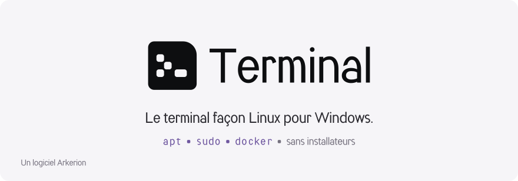
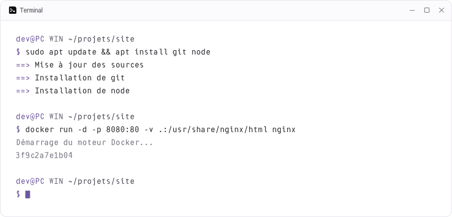

<p align="center">
  <picture>
    <source media="(prefers-color-scheme: dark)" srcset="docs/brand/banniere-sombre.svg">
    
  </picture>
</p>

<p align="center">
  <a href="docs/installation.md"><b>Installer</b></a>
  &nbsp;&nbsp;·&nbsp;&nbsp;
  <a href="docs/commandes.md">Commandes</a>
  &nbsp;&nbsp;·&nbsp;&nbsp;
  <a href="docs/apt.md">apt</a>
  &nbsp;&nbsp;·&nbsp;&nbsp;
  <a href="docs/docker.md">Docker léger</a>
  &nbsp;&nbsp;·&nbsp;&nbsp;
  <a href="docs/developpement.md">Contribuer</a>
</p>

<br>

**Terminal** apporte les habitudes de Linux à Windows. Tu l'ouvres d'un double-clic, comme Git Bash, et tu tapes
`sudo apt update`, `apt install git`, `ls`, `rm -rf` ou `docker run`, sans jamais passer par un installateur.
Les programmes et commandes Windows continuent de fonctionner à côté.

<p align="center">
  <picture>
    <source media="(prefers-color-scheme: dark)" srcset="docs/brand/apercu-sombre.svg">
    
  </picture>
</p>

## Ce que ça change

<table>
  <tr>
    <td width="50%" valign="top">
      <picture>
        <source media="(prefers-color-scheme: dark)" srcset="docs/brand/icone-commandes-sombre.svg">
        
      </picture>
      <h3>Les commandes Linux</h3>
      <code>ls</code>, <code>cd</code>, <code>cat</code>, <code>rm -rf</code>, <code>cp -r</code>, <code>mkdir -p</code>,
      les enchaînements <code>&amp;&amp;</code> et <code>||</code>… Le prompt ressemble à celui de Linux et tout le reste
      (<code>git</code>, <code>code .</code>, PowerShell) marche comme avant.
      <br><br><a href="docs/commandes.md">Les commandes intégrées →</a>
    </td>
    <td width="50%" valign="top">
      <picture>
        <source media="(prefers-color-scheme: dark)" srcset="docs/brand/icone-paquets-sombre.svg">
        
      </picture>
      <h3>apt, branché sur winget</h3>
      <code>apt install git node vscode</code> installe tes logiciels, <code>apt upgrade</code> les met tous à jour,
      <code>apt full-upgrade</code> ajoute les mises à jour de Windows. Fini les installateurs à télécharger.
      <br><br><a href="docs/apt.md">Tout sur apt →</a>
    </td>
  </tr>
  <tr>
    <td width="50%" valign="top">
      <picture>
        <source media="(prefers-color-scheme: dark)" srcset="docs/brand/icone-admin-sombre.svg">
        
      </picture>
      <h3>sudo, comme sous Linux</h3>
      <code>sudo</code> lance une commande en administrateur, dans la même fenêtre si le sudo de Windows 11 est activé.
      Pour installer un logiciel, tu n'en as même pas besoin : la fenêtre UAC s'ouvre seule.
      <br><br><a href="docs/commandes.md#sudo">Comment marche sudo →</a>
    </td>
    <td width="50%" valign="top">
      <picture>
        <source media="(prefers-color-scheme: dark)" srcset="docs/brand/icone-docker-sombre.svg">
        
      </picture>
      <h3>Docker, sans Docker Desktop</h3>
      <code>apt install docker</code> installe le vrai Docker Engine dans une mini machine Alpine Linux. Il démarre
      à la première commande et s'éteint tout seul quand tu ne t'en sers plus.
      <br><br><a href="docs/docker.md">Le Docker léger →</a>
    </td>
  </tr>
</table>

## Démarrage rapide

Il faut [Go](https://go.dev/dl/) pour compiler (ou `winget install GoLang.Go`).

```powershell
git clone https://github.com/Orvaen/terminal
cd terminal
powershell -ExecutionPolicy Bypass -File .\build.ps1
```

Le script compile, installe et ouvre le terminal. Tu le retrouves ensuite dans le menu Démarrer, sur le Bureau et dans
les onglets de Windows Terminal. Toutes les options sont dans le [guide d'installation](docs/installation.md).

```text
$ sudo apt update && apt install git node vscode
$ mkdir -p projet/src && cd projet && code .
$ apt install docker && docker run --rm hello-world
$ sudo apt full-upgrade
```

## Documentation

| Page | Contenu |
|---|---|
| [Installation](docs/installation.md) | Compiler, installer, mettre à jour, désinstaller |
| [Commandes](docs/commandes.md) | Le terminal, les commandes intégrées, les enchaînements, `sudo` |
| [apt](docs/apt.md) | Installer et mettre à jour logiciels et Windows, noms de paquets |
| [Docker léger](docs/docker.md) | Docker Engine sans Docker Desktop : fonctionnement, commandes, limites |
| [Identité](docs/identite.md) | Le logo et les couleurs de Terminal, dans l'identité Arkerion |
| [Développement](docs/developpement.md) | Structure du code, tests, CI, releases, visuels |

<br>

<p align="center">
  <a href="https://orvaen.github.io/Arkerion-Docs/">
    <picture>
      <source media="(prefers-color-scheme: dark)" srcset="docs/brand/arkerion/arkerion-logo-blanc.svg">
      
    </picture>
  </a>
</p>
<p align="center"><sub>Terminal est un logiciel conçu et développé par Arkerion.</sub></p>
