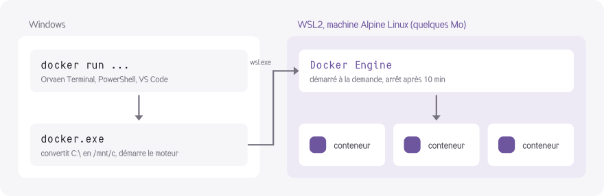

<picture>
  <source media="(prefers-color-scheme: dark)" srcset="brand/terminal-symbole-blanc.svg">
  
</picture>

# Docker léger

[← Retour à l'accueil](../README.md)

`apt install docker` installe le **vrai Docker Engine**, sans Docker Desktop : pas d'interface, pas de service
Windows, pas d'icône dans la barre des tâches, et rien qui tourne quand tu ne t'en sers pas.

```text
$ apt install docker
$ docker run --rm hello-world
$ docker run -d -p 8080:80 -v C:\Users\dev\site:/usr/share/nginx/html nginx:alpine
$ docker compose up -d
```

## Comment ça marche

<p align="center">
  <picture>
    <source media="(prefers-color-scheme: dark)" srcset="brand/schema-docker-sombre.svg">
    
  </picture>
</p>

Les conteneurs ont besoin d'un noyau Linux, que Windows n'a pas : il faut donc une petite machine virtuelle Linux.
Docker Desktop en utilise déjà une, dans WSL2, mais il ajoute tout le reste par-dessus. Le Docker léger garde
seulement l'essentiel :

1. **WSL2**, le Linux intégré à Windows, activé si besoin ;
2. une mini machine **Alpine Linux** de quelques Mo, nommée `orvaen-docker`, séparée de tes autres distributions ;
3. **Docker Engine** et **Docker Compose**, installés depuis les dépôts officiels d'Alpine.

La commande `docker` (intégrée au terminal, et `docker.exe` pour PowerShell, cmd ou VS Code) transmet tes commandes
à ce moteur.

## Installation

```text
$ apt install docker
```

| Étape | Détail |
|---|---|
| WSL2 | S'il n'est pas activé, une fenêtre administrateur s'ouvre pour l'activer. **Redémarre ton PC**, puis relance `apt install docker`. Cette étape n'arrive qu'une fois |
| Alpine Linux | Téléchargée depuis `dl-cdn.alpinelinux.org`, avec vérification de la somme SHA-256 |
| Docker Engine | Installé dans la machine avec Docker Compose |
| Premier démarrage | Le moteur démarre et `docker --version` s'affiche |

## Un moteur qui ne consomme rien au repos

- **Démarrage à la demande** : rien ne tourne tant que tu ne tapes pas `docker`. La première commande démarre
  le moteur en quelques secondes.
- **Arrêt automatique** : après **10 minutes** sans commande docker et sans conteneur actif, le moteur s'arrête et
  WSL libère toute la mémoire.
- **Indépendant du terminal** : tu peux fermer la fenêtre, tes conteneurs continuent de tourner.

Pour changer le délai, définis la variable d'environnement `ORVAEN_DOCKER_IDLE` (en secondes ; `0` désactive
l'arrêt automatique), puis redémarre le moteur avec `docker engine stop`.

## Au quotidien

| Situation | Ce qui se passe |
|---|---|
| Chemin Windows dans un volume | Converti automatiquement : `-v C:\projet:/app` devient `/mnt/c/projet:/app`, aussi dans `--mount source=…` |
| Port publié | `-p 8080:80` est accessible depuis Windows sur `localhost:8080` |
| Dossier courant | La commande s'exécute dans ton dossier courant : `docker compose up` trouve ton `compose.yaml` |
| Hors du terminal | `docker` marche aussi dans PowerShell, cmd et VS Code, grâce à `docker.exe` |

## Commandes du moteur

| Commande | Rôle |
|---|---|
| `docker engine status` | État du moteur et place occupée sur le disque |
| `docker engine start` | Démarre le moteur (automatique à la première commande) |
| `docker engine stop` | Arrête le moteur tout de suite et libère la mémoire |
| `docker engine logs` | Affiche les dernières lignes du journal du moteur |
| `apt upgrade docker` | Met à jour Docker Engine et Alpine (aussi fait par `apt upgrade`) |
| `apt remove docker` | Supprime la machine, avec tous ses conteneurs, images et volumes, après confirmation |

## Bon à savoir

- Les conteneurs s'arrêtent avec le moteur. Après un arrêt automatique ou un redémarrage du PC,
  relance-les (`docker compose up -d`).
- Les fichiers lus depuis `C:\` à travers `/mnt/c` sont plus lents que dans Linux. Pour un gros projet
  (des `node_modules` par exemple), préfère un volume Docker nommé.
- Si Docker Desktop est aussi installé, son `docker.exe` passe avant le nôtre dans PowerShell et cmd.
  Dans le terminal, c'est toujours le Docker léger qui répond. Pour ne garder que lui : `apt remove docker-desktop`.

## En cas de problème

| Symptôme | Piste |
|---|---|
| `Docker n'est pas installé` | Lance `apt install docker` |
| L'installation s'arrête après l'activation de WSL2 | C'est normal : redémarre le PC, puis relance `apt install docker` |
| `le moteur Docker ne répond pas` | Regarde `docker engine logs`, puis essaie `docker engine stop` et relance ta commande |
| Tout recommencer | `apt remove docker -y`, puis `apt install docker` |

Si le problème persiste, ouvre une [issue](https://github.com/Orvaen/terminal/issues) avec la sortie de
`docker engine logs` et de `wsl --version`.
