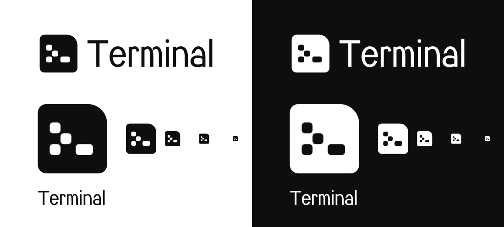

<picture>
  <source media="(prefers-color-scheme: dark)" srcset="brand/terminal-symbole-blanc.svg">
  
</picture>

# Identité

[← Retour à l'accueil](../README.md)

Terminal est un logiciel Arkerion. Son logo et ses visuels suivent l'identité d'Arkerion, décrite dans
[Arkerion Docs](https://orvaen.github.io/Arkerion-Docs/) : même grille, mêmes arrondis, noir et blanc pour le logo,
et le nom composé en **Arkerion Sans**.

  

## Le symbole Invite

Un module principal, l'écran, qui reprend l'**arrondi signature** d'Arkerion en haut à droite. L'invite de commande
y est creusée en modules : un chevron fait de trois carrés posés en diagonale, puis le curseur. On lit `>_`,
le signe universel du terminal, construit avec les blocs du symbole [Structure](https://orvaen.github.io/Arkerion-Docs/docs/identite/logo)
d'Arkerion et de l'Amas de Nebula.

| Règle de construction | Valeur |
|---|---|
| Grille | 64 unités (de 18 à 82, comme Structure et Amas) |
| Écran | Arrondi signature de 18 en haut à droite, 8 aux autres coins |
| Modules de l'invite | Carrés de 10, arrondi 3 ; curseur de 16 × 10 |
| Nom | Arkerion Sans Regular, composé resserré (−25), vectorisé |
| Logo complet | Symbole de 1000 unités, nom à 1250, même construction que Nebula |

## Fichiers

Tous les fichiers sont dans [`docs/brand`](brand). Le nom y est vectorisé : il s'affiche sans la police.

| Fichier | Usage |
|---|---|
| `terminal-logo-noir.svg`, `terminal-logo-blanc.svg` | Logo complet, usage principal |
| `terminal-symbole-noir.svg`, `terminal-symbole-blanc.svg` | Icône, favicon, petits formats |
| `terminal-nom-noir.svg`, `terminal-nom-blanc.svg` | Nom seul |
| `terminal-avatar-noir.svg`, `terminal-avatar-noir.png` | Avatar carré sur fond blanc (1024 px) |
| `terminal.ico` | Icône Windows des raccourcis et du profil Windows Terminal (16 à 256 px) |
| `terminal-partage.png` | Carte de partage (1280 × 640), réseaux sociaux et GitHub |

> [!TIP]
> Pour l'aperçu des liens vers le dépôt : *Settings › General › Social preview › Edit*, puis choisis
> `docs/brand/terminal-partage.png`.

## Règles d'usage

Les règles du logo Arkerion s'appliquent : zone de protection, tailles minimales, pas de déformation,
de recoloration ni d'effet. En plus :

- le logo existe en **noir** `#0D0E10` sur fond clair et en **blanc** sur fond sombre, jamais en couleur ;
- l'invite compte toujours trois modules et un curseur, dans cette disposition ;
- le symbole ne pivote pas : l'arrondi signature reste en haut à droite ;
- on n'associe pas le symbole Invite au nom Arkerion, ni l'inverse.

L'icône Windows ajoute un fin liseré blanc autour du symbole noir, pour qu'il reste lisible sur une barre des tâches
sombre.

## Couleurs de la documentation

L'**Améthyste** d'Arkerion est la couleur signature de l'interface : liens, accents, pictogrammes, invite et curseur
dans les aperçus. Elle n'est jamais appliquée au logo. Les fonds restent neutres et doux pour les yeux.

| Rôle | Clair | Sombre |
|---|---|---|
| Fond | `#F6F5F8` | `#141317` |
| Surface | `#FFFFFF` | `#1B1A1F` |
| Filet | `#E6E3EC` | `#2E2C35` |
| Texte | `#2B2A30` | `#ECEAF0` |
| Texte discret | `#76727F` | `#9A96A4` |
| Améthyste | `#6E569F` | `#B4A4D6` |

Les visuels existent en version claire et sombre : GitHub affiche automatiquement celle qui correspond à ton thème.

## Régénérer les visuels

Tous les fichiers de `docs/brand` sont produits par [`docs/brand/build.py`](brand/build.py), à partir des polices
Arkerion Sans et Arkerion Mono du dépôt Arkerion-Docs. Voir [Développement › Visuels](developpement.md#visuels).
